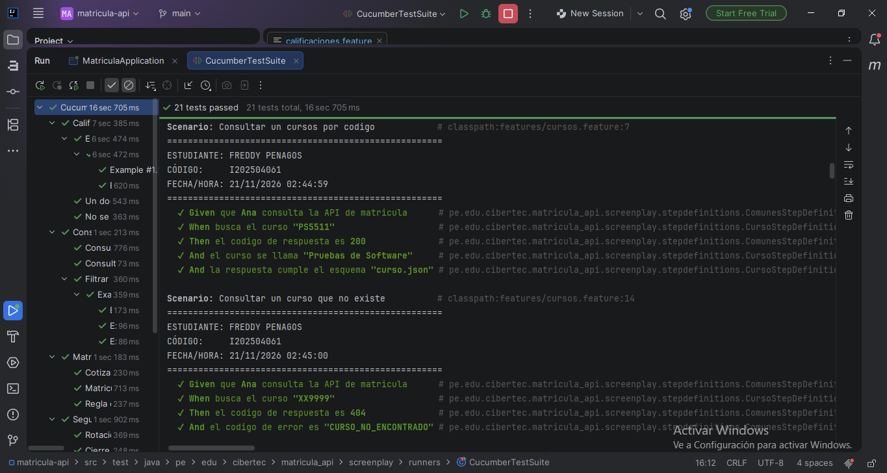
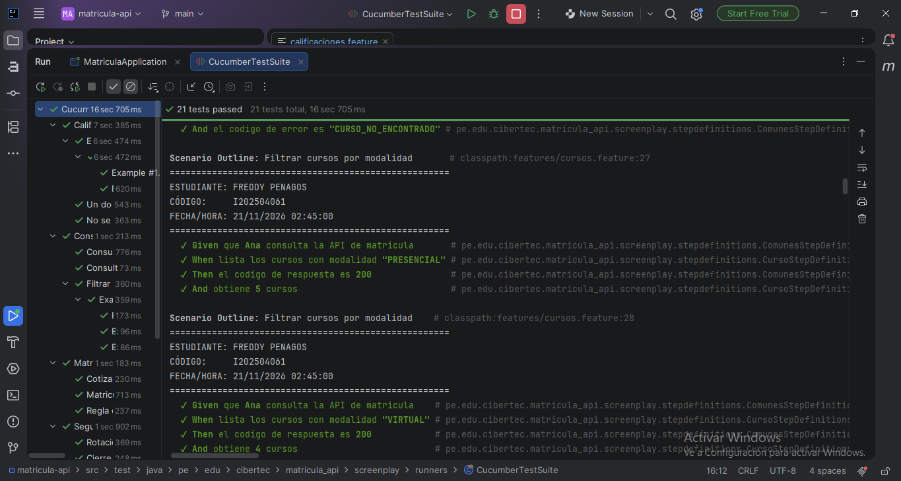
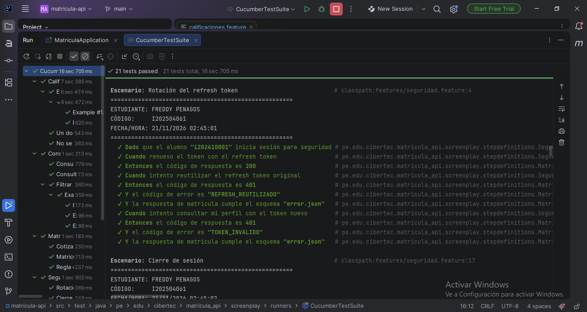
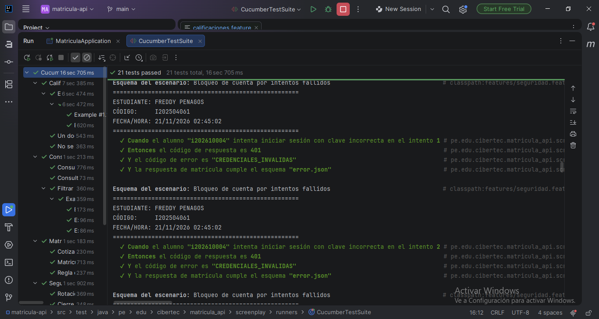
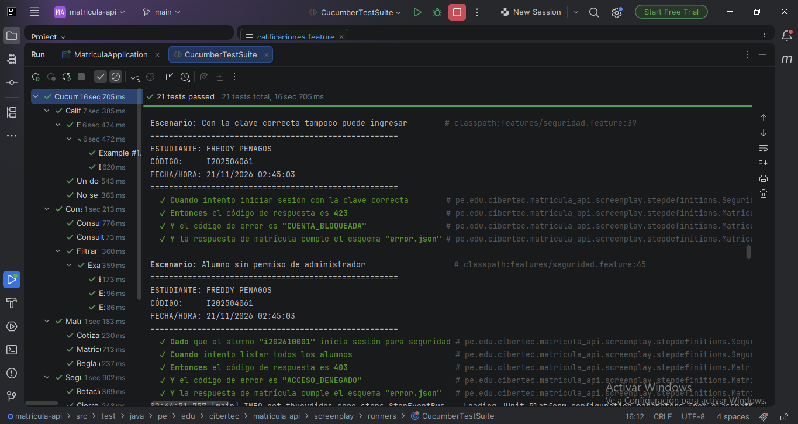
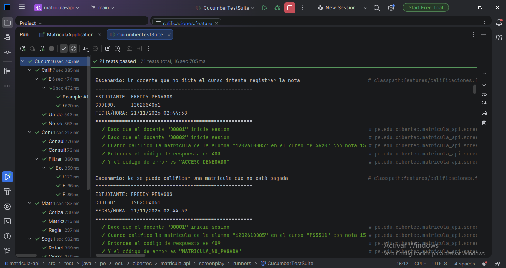
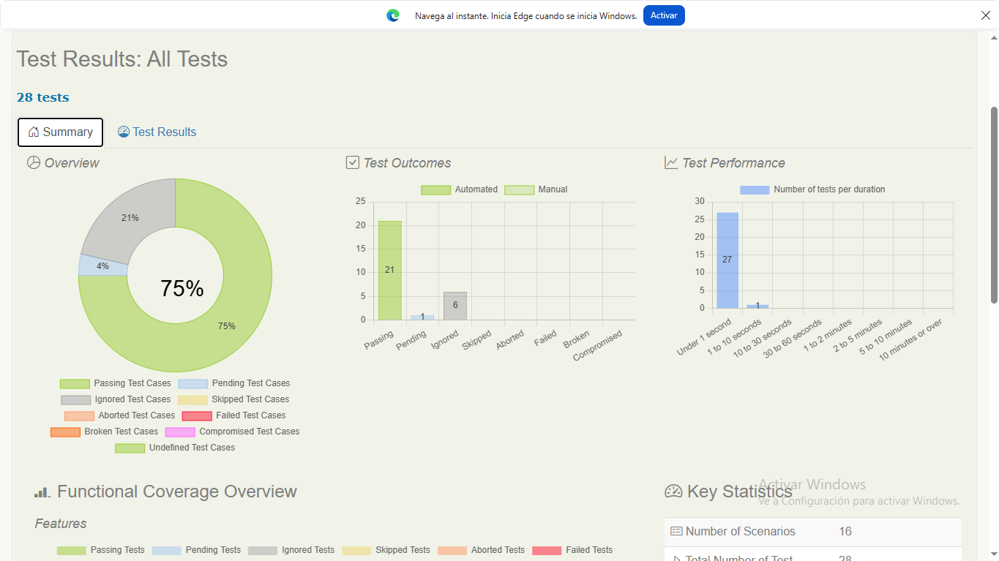
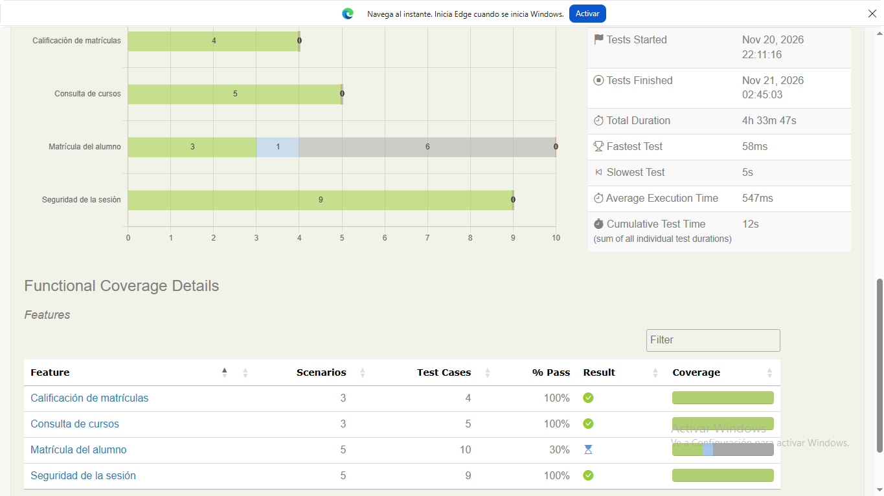
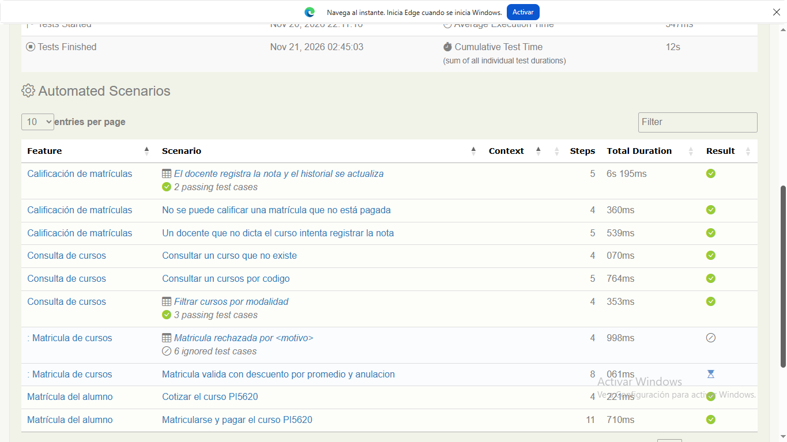
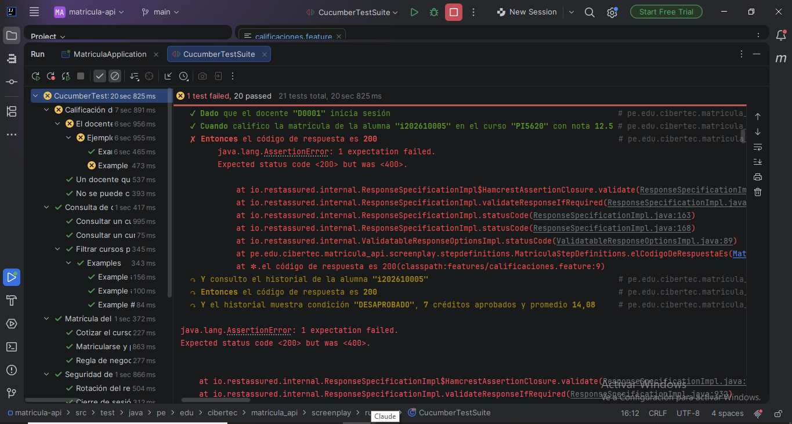

# Informe de Examen - Pruebas de Software
**Curso:** 2424 – Pruebas de Software | **Evaluación:** Continua T1
**Alumno:** FREDDY PENAGOS
**Código:** I202504051 (D = 1)
**Repositorio:** https://github.com/Luisyano/matricula-api

**Datos de mi fila (D = 1):** alumno `i202610001`, curso `PI5620`, método de pago `TARJETA`, regla que debe fallar: cotizar `PS5511`, `QA5517`, `DM5512`, `TS5514`, `SA5516` y `BD5410`.

**Resultado final:** 21 pruebas ejecutadas, 21 exitosas.

---

## Pregunta 1: Automatización BDD con Gherkin + Cucumber y Rest Assured

Archivos: `matricula.feature` (en español) y `MatriculaStepDefinitions.java`. El id de la matrícula se toma de la respuesta de la API, no está escrito fijo.

### Captura de la ejecución (consola con Hook)

### Escenario 1: Cotizar el curso PI5620
| Concepto | Cálculo | Monto |
| :--- | :--- | :--- |
| **Créditos del curso** | - | 6 |
| **Subtotal** | 6 créditos × S/ 120 | S/ 720.0 |
| **Descuento (20%)** | 720 × 0.20 (promedio 18) | - S/ 144.0 |
| **Total a pagar** | 720 - 144 | **S/ 576.0** |

Verificado: código 200 y total `576.0`.

### Escenario 2: Matricularse y pagar
| Verificación | Valor esperado |
| :--- | :--- |
| Crear matrícula | 201, estado `REGISTRADA`, monto `576.0` (igual a la cotización) |
| Esquema de la respuesta | cumple `schemas/matricula.json` |
| Pagar con `TARJETA` | 200, estado `PAGADA`, `fechaPago` con valor |
| `GET /api/pagos` | existe el pago de la matrícula (mismo `idMatricula`), método `TARJETA` y `numeroOperacion` con formato `OP-000000` |

### Escenario 3: Regla de negocio que debe fallar
La cotización de los 6 cursos responde **HTTP 422** con el código de error **`LIMITE_CREDITOS`**, y la respuesta cumple `schemas/error.json`.

**Explicación:** la regla que produce el error es el tope máximo de 24 créditos por periodo: la suma de créditos de los 6 cursos lo supera. Las demás validaciones (alumno existente, cursos existentes, sesión con token válido) sí se cumplen, por eso no detienen la petición antes y se llega a evaluar el límite de créditos sobre el total solicitado.

---

## Pregunta 2: Seguridad de la API con Serenity Screenplay

Archivos: `seguridad.feature` (en español), `SeguridadStepDefinitions.java` y las Tasks `IniciarSesion`, `RenovarToken` y `CerrarSesion`. El actor tiene la habilidad `CallAnApi` y guarda sus tokens con `remember` y `recall`.

### Captura de la ejecución (consola con Hook)

### Códigos de error descubiertos
| Escenario | HTTP | `codigo` |
| :--- | :--- | :--- |
| Refresh token reutilizado | 401 | `REFRESH_REUTILIZADO` |
| Access token nuevo después del reuso | 401 | `TOKEN_INVALIDO` |
| Logout | 204 | - |
| Perfil después de cerrar sesión | 401 | `TOKEN_INVALIDO` |
| Intentos 1 a 4 con clave incorrecta (`i202610004`) | 401 | `CREDENCIALES_INVALIDAS` |
| Intento 5 con clave incorrecta | 423 | `CUENTA_BLOQUEADA` |
| Clave correcta después del bloqueo | 423 | `CUENTA_BLOQUEADA` |
| Alumno `i202610001` lista alumnos (`GET /api/alumnos`) | 403 | `ACCESO_DENEGADO` |

Todas las respuestas de error cumplen `schemas/error.json`.

### Respuestas a las preguntas teóricas

**1. ¿Por qué el accessToken nuevo también es rechazado después de usar el refresh token por segunda vez?**
Al intentar reutilizar un refresh token que ya había sido usado, la API lo interpreta como un posible robo de sesión. Como medida de seguridad, invalida todas las sesiones activas de ese usuario, incluyendo los tokens recién generados.

**2. ¿Por qué con la clave correcta tampoco puede ingresar después de 5 intentos fallidos?**
Porque la cuenta se bloquea automáticamente por 15 minutos como protección contra ataques de fuerza bruta. El bloqueo impide cualquier intento de inicio de sesión, sea correcta o no la clave.

---

## Pregunta 3: Calificaciones e historial

Archivos: `calificaciones.feature` (en español), `CalificacionStepDefinitions.java`, las Tasks `CalificarMatricula` y `ConsultarHistorial`, y la Question `HistorialQuestion`. El id de la matrícula se obtiene con `GET /api/matriculas` usando el token de la alumna, y la respuesta del historial cumple `schemas/historial.json`.

### Captura de la ejecución (consola con Hook)

### Captura del reporte de Serenity

### Tabla de cálculo del historial
Historial de Rosa Medina (`i202610005`): AS5402 (3 créditos, nota 16, APROBADO), LP5401 (4 créditos, nota 15, APROBADO) y PI5620 (6 créditos, nota según la fila).

| Nota en PI5620 | Condición | Créditos aprobados | Cálculo del promedio ponderado | Promedio |
| :--- | :--- | :--- | :--- | :--- |
| 11 | DESAPROBADO | 7 | (16×3 + 15×4 + 11×6) / 13 = 174 / 13 | 13,38 |
| 12,5 | DESAPROBADO | 7 | (16×3 + 15×4 + 12,5×6) / 13 = 183 / 13 | 14,08 |

PI5620 queda DESAPROBADO con 11 y con 12,5 porque la nota mínima aprobatoria es 13. Por eso solo suman los créditos de AS5402 y LP5401 (3 + 4 = 7). El promedio ponderado sí incluye los tres cursos (13 créditos).

### Escenarios adicionales
| Escenario | HTTP | `codigo` |
| :--- | :--- | :--- |
| Docente `D0002` (no dicta el curso) intenta calificar | 403 | `ACCESO_DENEGADO` |
| Calificar la matrícula de PS5511 (no pagada) | 409 | `MATRICULA_NO_PAGADA` |

### Captura del error con el punto decimal

**Qué ocurre:** al escribir `12.5` (con punto) en la tabla de Ejemplos, el paso `el código de respuesta es 200` falla con `Expected status code <200> but was <400>`: la API respondió HTTP **400** (solicitud inválida) al registrar la nota. Los pasos siguientes (consultar el historial) quedan omitidos. En esa misma ejecución la fila con nota 11 pasó correctamente (20 pruebas exitosas y 1 fallida, de 21).

**Causa:** el feature está escrito en español (`# language: es`), por lo que Cucumber interpreta los números decimales con la configuración regional española, donde el punto es separador de miles y la coma es el separador decimal. Así, `12.5` se lee como 125, que es una nota inválida (fuera del rango 0 a 20). La solución es escribir `12,5` con coma. Por la misma razón, los promedios esperados se escriben `13,38` y `14,08` en el feature.