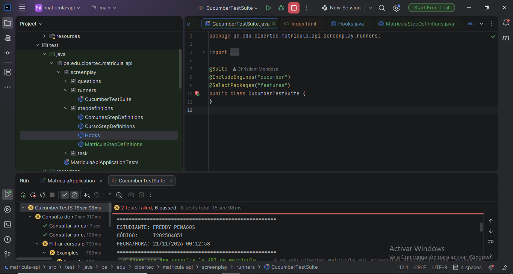
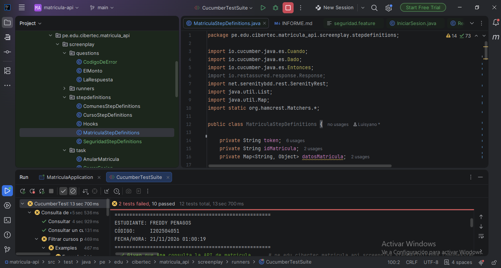

# Informe de Examen - Pruebas de Software
Alumno: FREDDY PENAGOS
Código: I202504051

## Pregunta 1: Automatización BDD con Gherkin + Cucumber

### Captura de la ejecución (Consola con Hook)

### Tabla de cálculo - Cotización PI5620
| Concepto | Cálculo | Monto |
| :--- | :--- | :--- |
| **Créditos del curso** | - | 6 |
| **Subtotal** | 6 créditos × S/ 120 | S/ 720.0 |
| **Descuento (20%)** | 720 × 0.20 (promedio 18) | - S/ 144.0 |
| **Total a pagar** | 720 - 144 | **S/ 576.0** |

**Explicación del error (Límite de créditos):**
La cotización de los 6 cursos falla con código HTTP 422 y el código `LIMITE_CREDITOS` porque la suma de créditos supera el tope máximo de 24 permitidos por periodo.

## Pregunta 2: Seguridad de la API con Serenity Screenplay

### Captura de la ejecución (Consola con Hook)

### Respuestas a las preguntas teóricas

**1. ¿Por qué el accessToken nuevo también es rechazado después de usar el refresh token por segunda vez?**
El nuevo accessToken es rechazado porque, al intentar reutilizar un refresh token que ya había sido usado, la API lo interpreta como un posible robo de sesión. Como medida de seguridad, invalida inmediatamente todas las sesiones activas de ese usuario, incluyendo los tokens recién generados.

**2. ¿Por qué con la clave correcta tampoco puede ingresar después de 5 intentos fallidos?**
Porque la cuenta se bloquea automáticamente por 15 minutos como mecanismo de protección contra ataques de fuerza bruta. Este bloqueo impide cualquier intento de inicio de sesión, independientemente de si la contraseña ingresada es correcta o no.